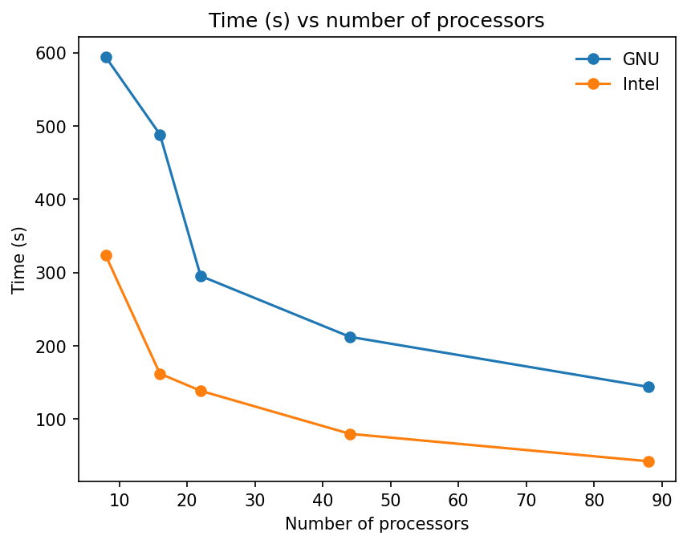

# 0. CuO SCF

Note that the SCF calculation is terminated after 4 SCF loops
(`electron_maxstep=4`), see input file `pw.cuo.scf.in` for the details.

| File Name              |   nproc | Build   |   nodes |   Time (s) | Comment            |
|:-----------------------|--------:|:--------|--------:|-----------:|:-------------------|
| pw.cuo.scf.gnu.0.out   |       8 | GNU     |       1 |     594.28 | Azure              |
| pw.cuo.scf.gnu.1.out   |      16 | GNU     |       1 |     488.41 | Azure              |
| pw.cuo.scf.gnu.2.out   |      22 | GNU     |       1 |     295.21 | Azure              |
| pw.cuo.scf.gnu.3.out   |      44 | GNU     |       1 |     212.08 | Azure              |
| pw.cuo.scf.gnu.4.out   |      44 | GNU     |       2 |     143.7  | Azure (Infiniband) |
| pw.cuo.scf.gnu.5.out   |      60 | GNU     |       2 |     537.48 | GCP (Ethernet)     |
| pw.cuo.scf.gnu.6.out   |      60 | GNU     |       1 |     257.34 | GCP                |
| pw.cuo.scf.intel.0.out |       8 | Intel   |       1 |     323.41 | Azure              |
| pw.cuo.scf.intel.1.out |      16 | Intel   |       1 |     161.82 | Azure              |
| pw.cuo.scf.intel.2.out |      22 | Intel   |       1 |     138.41 | Azure              |
| pw.cuo.scf.intel.3.out |      44 | Intel   |       1 |      79.66 | Azure              |
| pw.cuo.scf.intel.4.out |      44 | Intel   |       2 |      42.2  | Azure (Infiniband) |
| pw.cuo.scf.gpu.0.out   |      12 | CUDA    |       1 |      41.81 | GCP                |



# Using Pandas to process the data

```py
import pandas as pd

# Building first dataframe
data = {
    "File Name": ["pw.cuo.scf.gnu.0.out"],
    "nproc": [8],
    "Build": ["GNU"],
    "nodes": [1],
    "Time (s)": [594.28]
    }
df = pd.DataFrame(data)

# Saving dataframe to CSV
df.to_csv('data.csv', index=False)

# Reading dataframe from CSV
df = pd.read_csv('data.csv')

# add new data
data = {
    "File Name": ["pw.cuo.scf.gnu.1.out"],
    "nproc": [16],
    "Build": ["GNU"],
    "nodes": [1],
    "Time (s)": [488.41]
    }
df = pd.concat([df, pd.DataFrame(data)], ignore_index=True)
df.to_csv("data.csv", index=False)

# Print markdown table
print(df.to_markdown(index=False))
```
